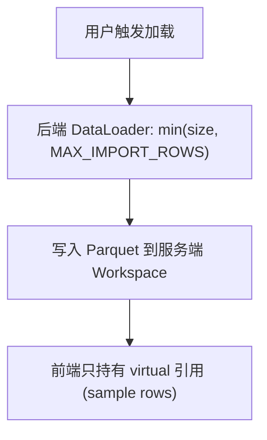
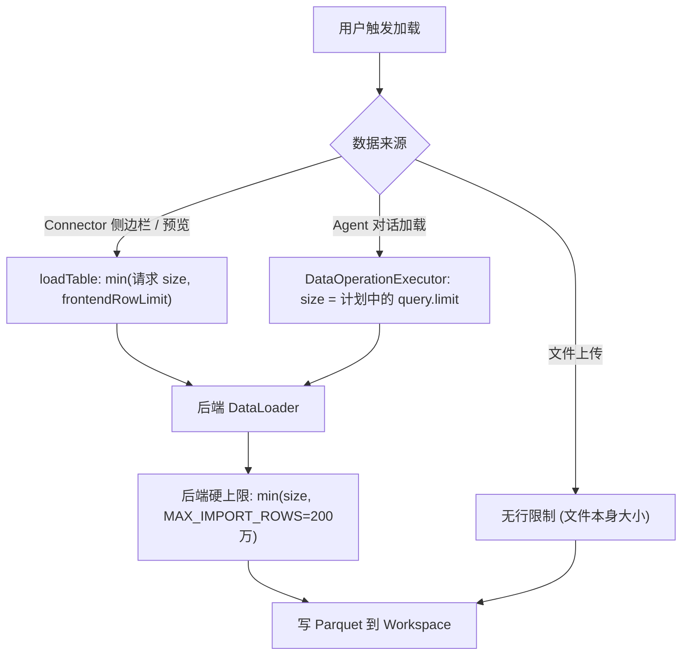

# 13 — 统一行数限制

> **Scope**: 数据加载行数限制的架构设计、各 Workspace 后端下的行为、前后端限制协同。
> **最后更新**: 2026-10-13

---

## 1. 设计目标

- **手动导入的用户入口**: Settings 对话框的 `frontendRowLimit` 控制从连接器手动导入表时的行数上限
- **后端兜底**: `MAX_IMPORT_ROWS = 2_000_000` 硬上限，防止异常请求
- **存储模式统一**: 所有 Workspace 后端（`local` / `azure_blob` / `ephemeral`）都在服务端存储表数据，使用相同的限制语义

---

## 2. Workspace 存储模式



- **`local`**（默认）/ **`azure_blob`**: 数据持久化在服务端 parquet 文件中，前端只保留 sample。Agent 运算在后端完成。
- **`ephemeral`**: 同样使用服务端磁盘上的 workspace 格式，但存放在独立根目录下，由 TTL / LRU 自动清理（`py-src/data_formulator/datalake/ephemeral_workspace.py`），用于演示/匿名部署。浏览器 IndexedDB（`src/app/workspaceDB.ts`）只保存会话结构和元数据的恢复快照，不保存表行。

三种模式下行数限制的行为一致。

---

## 3. 限制常量一览

| 常量 | 值 | 位置 | 说明 |
|------|---|------|------|
| `MAX_IMPORT_ROWS` | 2,000,000 | `py-src/data_formulator/data_loader/external_data_loader.py` | 后端硬上限，DataLoader 的 `fetch_data_as_arrow()` 强制执行 |
| `DEFAULT_ROW_LIMIT` | 2,000,000 | `src/app/dfSlice.tsx` | `frontendRowLimit` 默认值，同时是 Settings 输入上限 |
| `MAX_AGGREGATE_ROWS` | 10,000 | `py-src/data_formulator/data_operations/executor.py` | Agent 加载中聚合 / native / semantic 查询的结果行数上限 |
| `external_table_max_rows` | 1,000,000 | `py-src/data_formulator/configuration.py`（`EXTERNAL_TABLE_MAX_ROWS`） | 超过该行数的连接器表以引用方式加入，不直接导入 |
| `external_table_max_bytes` | 512 MB | `py-src/data_formulator/configuration.py`（`EXTERNAL_TABLE_MAX_SIZE_MB`） | 同上，按文件 / 表大小判断 |
| `max_display_rows` | 10,000 | `py-src/data_formulator/configuration.py`（`MAX_DISPLAY_ROWS`） | Agent 执行结果返回前端的**展示**行数上限，不限制存储 |

`configuration.py` 中的 `LIMITS` 通过 `effective_limit()` 读取：CLI 参数 / 环境变量优先，其次是 Configuration 视图 Limits 标签保存的覆盖值。设置了对应环境变量时该项在 UI 中锁定。

---

## 4. 数据流



### 4.1 Connector 侧边栏 / DBTableManager 加载

1. 前端 `src/app/tableThunks.ts` 的 `loadTable` thunk 对数据库来源调用 `resolveDatabaseImportLimit(importOptions.size, frontendRowLimit)`：请求了 size 时取 `min(size, frontendRowLimit)`，否则取 `frontendRowLimit`，写入 `import_options.size` 后 POST `/api/connectors/import-data`
2. 后端 `ingest_to_workspace()` 调用 DataLoader 的 `fetch_data_as_arrow()`，执行 `size = min(opts.get("size", MAX_IMPORT_ROWS), MAX_IMPORT_ROWS)`
3. 数据写入 Workspace parquet。若生效的是 `frontendRowLimit` 上限且返回行数达到该上限，`loadTable` 返回 `truncated: true`，由调用方（如 `DataSourceSidebar`）提示用户

**大表 / 语义模型**: `src/app/workspaceService.ts` 的 `loadsAsConnectorReference()` 判断表的 `row_count` 超过 `EXTERNAL_TABLE_MAX_ROWS`、大小超过 `EXTERNAL_TABLE_MAX_BYTES`，或是 semantic 模型时，以外部表引用加入，由 Agent 在源端查询。对引用执行"导入完整副本"（`importExternalTableReference`，`full_copy: true`）时，后端先统计行数，超过 `MAX_IMPORT_ROWS` 直接拒绝。

### 4.2 Agent 对话加载

1. `AnalystAgent` 的数据加载 skill（`py-src/data_formulator/analyst/skills/workspace/data_loading.py`）提出 DataOperation 计划，用户选择后由 `DataOperationExecutor`（`py-src/data_formulator/data_operations/executor.py`）执行
2. `_build_import_options()` 仅在计划步骤有 `query.limit` 时设置 `size`；否则使用 Loader 默认值（通常为 `MAX_IMPORT_ROWS`）。此路径不使用 `frontendRowLimit`
3. 含 `group_by` / `aggregates` / `native` 查询或 semantic 来源时走 `execute_aggregate_query()`，结果最多 `MAX_AGGREGATE_ROWS`（10,000）行；未显式指定 limit 且超出时报错
4. 无具体查询的整表加载，若源表超过 `external_table_max_rows` / `external_table_max_bytes` 或为 semantic 来源，只作为外部表引用加入，不导入

### 4.3 文件上传

文件上传不受 `frontendRowLimit` 限制。文件全量存入 Workspace parquet。

---

## 5. 前端 Settings 对话框

- 路径: `src/app/App.tsx` → Settings Dialog
- 输入范围: `[100, DEFAULT_ROW_LIMIT]`，即 `[100, 2_000_000]`
- 默认值: 2,000,000（所有 Workspace 模式相同）
- 保存时通过 `dfActions.setConfig` 写入 `config.frontendRowLimit`，后续连接器导入使用新值

---

## 6. 后端硬上限

每个 DataLoader 的 `fetch_data_as_arrow()` 方法中：

```python
from data_formulator.data_loader.external_data_loader import MAX_IMPORT_ROWS

opts = import_options or {}
size = min(opts.get("size", MAX_IMPORT_ROWS), MAX_IMPORT_ROWS)
```

即使前端传入超过 200 万的 size，后端也会截断。这是安全兜底，防止异常请求导致 OOM。

个别 Loader 的写法不同但同样以 `MAX_IMPORT_ROWS` 封顶：`local_folder` 未传 size 时默认取 1,000,000 行；`clickhouse` 通过 `_validated_size()` 校验后取 `min(size, MAX_IMPORT_ROWS)`。

---

## 7. 新 Loader 开发注意

实现 `fetch_data_as_arrow()` 时必须：

1. 从 `external_data_loader` 导入 `MAX_IMPORT_ROWS`
2. 使用 `size = min(opts.get("size", MAX_IMPORT_ROWS), MAX_IMPORT_ROWS)` 解析 size
3. 在 SQL/API 查询中使用该 size 作为 LIMIT

```python
from data_formulator.data_loader.external_data_loader import (
    ExternalDataLoader, CatalogNode, MAX_IMPORT_ROWS,
)

class MyDataLoader(ExternalDataLoader):
    def fetch_data_as_arrow(self, source_table, import_options=None):
        opts = import_options or {}
        size = min(opts.get("size", MAX_IMPORT_ROWS), MAX_IMPORT_ROWS)
        # ... use size in your query
```

---

## 8. `max_display_rows` 与行数限制的区别

| | `frontendRowLimit` / `MAX_IMPORT_ROWS` | `max_display_rows` |
|---|---|---|
| 控制什么 | 从数据源拉取并存储的最大行数 | Agent 执行结果 / 派生数据刷新返回前端**展示**的行数 |
| 何时生效 | 数据导入时 | Agent 代码执行后、`/api/agent/refresh-derived-data` 返回结果时 |
| 数据是否保留 | 是（全量存 Workspace） | 是（全量在 Workspace，只是前端展示截断） |
| 默认值 | 2,000,000 | 10,000 |
| 用户可配 | Settings 对话框 | CLI `--max-display-rows` / 环境变量 `MAX_DISPLAY_ROWS` / Configuration 视图 Limits 标签 |
